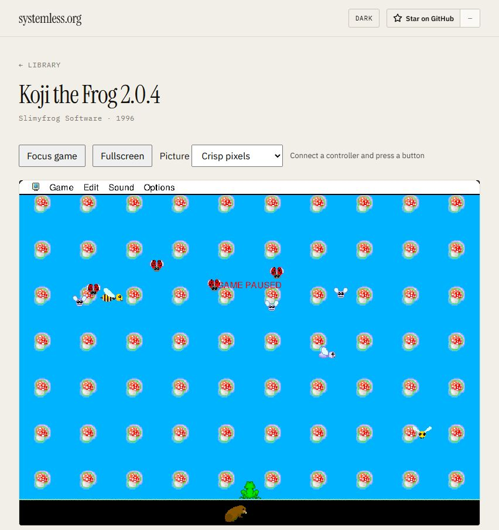

# Verification — 2026-11-06

## Build and packaging

- Original fork baseline: commit `584f6e867b6511d1cffe4d2977f3c4521e33c4bb`, Systemless 0.110.1. Baseline release browser build passed.
- Final private release build passed with `scripts/Build-KojiBrowser.ps1`. The build reports six existing warnings in the core library; no build errors.
- Static bundle: 31 files, 23,140,960 bytes (approximately 22.1 MiB), in `C:\Projects\systemless\www\dist`.
- Final WebAssembly: `systemless-org-62eaf93cc8afcb1e_bg.wasm`; SHA-256 `076395376e0cdbd144fdf0bebc831eb4e38d3779ee12e63b4069f2944b7888d1`.
- Packaging verifies that the WebAssembly contains the private game ID before copying media. The private compile flag refuses the public-production flag.
- Original `001` and `Boot` images were rehashed at final verification and still matched the extraction provenance. The private HFS image also matched its extraction hash. Nine files passed data/resource fork and type/creator round-trip checks.
- Git ignore checks passed for private media, extraction provenance, distribution output, and the local iteration notes. No commits or pushes were made.
- `git diff --check`, Python syntax checks, PowerShell parsing, and the two Node controller tests passed. Controller tests cover simultaneous inputs, analog deadzone, standard mapping requirement, shoulder/drop/pause buttons, held-input suppression, direction changes, and release on disconnect.

## Browser checks

Test URL: `http://localhost:8087/koji-the-frog/`, using the in-app Chromium browser on this PC.

- Root route redirects to the game; game page returns HTTP 200. WebAssembly is served as `application/wasm`, with the intended cross-origin isolation headers.
- The private 2.0.4 application launches and recognizes the existing registration preferences.
- Play reaches the first level. Left-arrow input moves Koji left; I causes a visible jump. P pauses the game. The original saved keypad/Command bindings are preserved through browser aliases.
- Fullscreen scales the game while preserving its aspect ratio. The added Exit fullscreen button returns to the page. This button avoids reliance on embedded browsers handling Escape themselves.
- The picture selector changes canvas image rendering between `pixelated` and `auto`, and the setting survives reload. It was restored to crisp pixels after testing.
- Saved files UI is reachable and offers MacBinary import/export. No new save file was generated during the smoke test.
- No warning/error console messages were reported in the final browser run.
- The Windows PowerShell launcher was tested for initial launch, reuse of an existing server, matching-process stop, and restart. The server binds to 127.0.0.1 only. A private local preview remains available; `Stop-Koji.cmd` stops it.

## Limits of this check

This is a smoke-tested launch of the original Mac executable through Systemless, not an HTML5 rewrite or a full compatibility certification. A physical controller was not available/connected for a hardware test; its adapter is covered by code tests. Tongue, water-drop and diagonal-jump mappings are implemented, but their gameplay outcomes were not independently verified. Complete levels, all difficulty modes, audio fidelity, and save/export/import round trips remain unverified. Mobile touch controls are configured but were not tested on a physical mobile device.

No HomeHub deployment was performed. The Caddy example and read-only static mount instructions are a future deployment handoff, subject to that repository's workflow and existing private access controls. No offline service-worker precache or replacement artwork was added.

